<h1 align="center">Robotic Backgammon</h1>

  <b>A real backgammon board that plays against you, or lets someone play from a phone anywhere in the world. 
  A robot hidden under the glass moves the checkers.</b>

  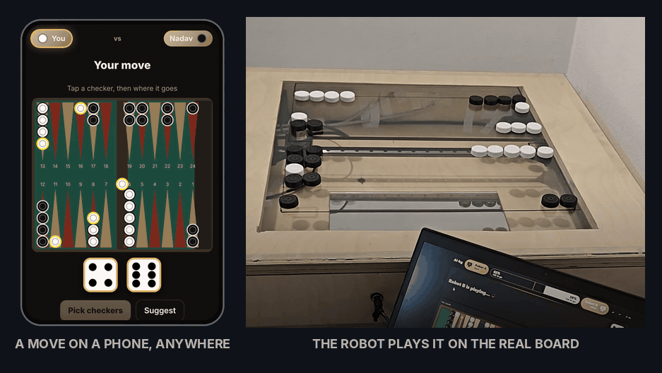

  ESP32-S3 &nbsp;·&nbsp; CoreXY &nbsp;·&nbsp; 12 V electromagnet &nbsp;·&nbsp; camera through a mirror &nbsp;·&nbsp; Python &nbsp;·&nbsp; GNU Backgammon

---

## How it moves

A cart on two rails runs under 4 mm tempered glass. It carries an electromagnet that grabs a checker from below and drags it to its place, along a path that keeps clear of every other checker.

<table>
  <tr>
    <td width="33%" align="center">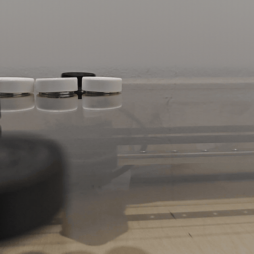</td>
    <td width="33%" align="center">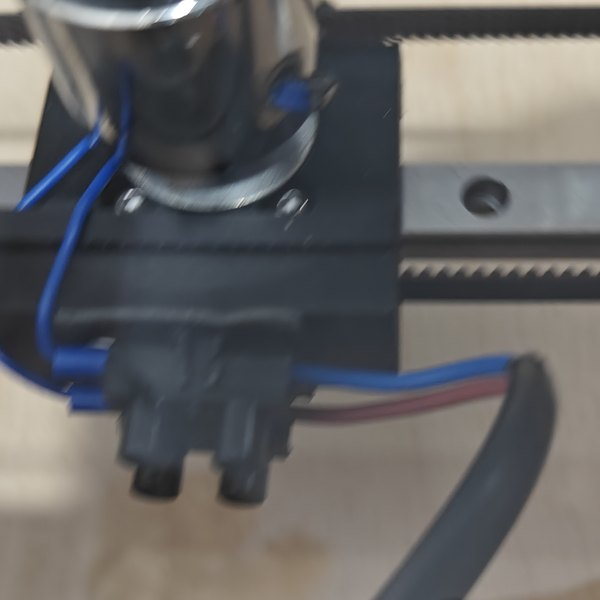</td>
    <td width="33%" align="center">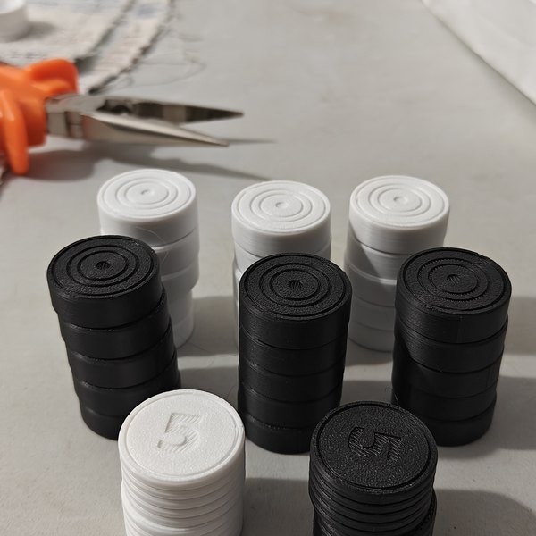</td>
  </tr>
  <tr>
    <td align="center"><b>Under the glass.</b> The magnet pulls the checker along.</td>
    <td align="center"><b>The cart.</b> CoreXY, two NEMA 17 motors, MGN12 rails, GT2 belts.</td>
    <td align="center"><b>The checkers.</b> 3D-printed, 26 mm, with a steel bottom.</td>
  </tr>
</table>

## How it sees

Most robot boards hang a camera above the table. This one keeps it inside the box: the camera sits at the centre of the back wall and looks into a mirror, up through the glass. The software straightens the view into a top-down image of the board.

  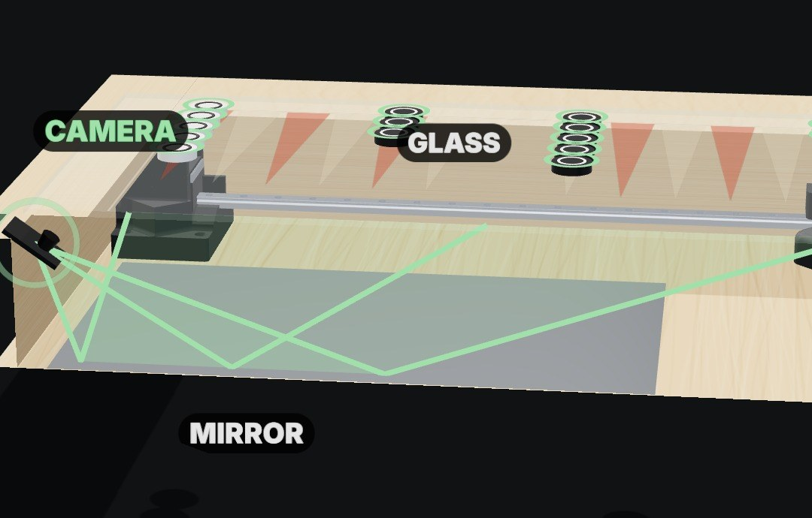

  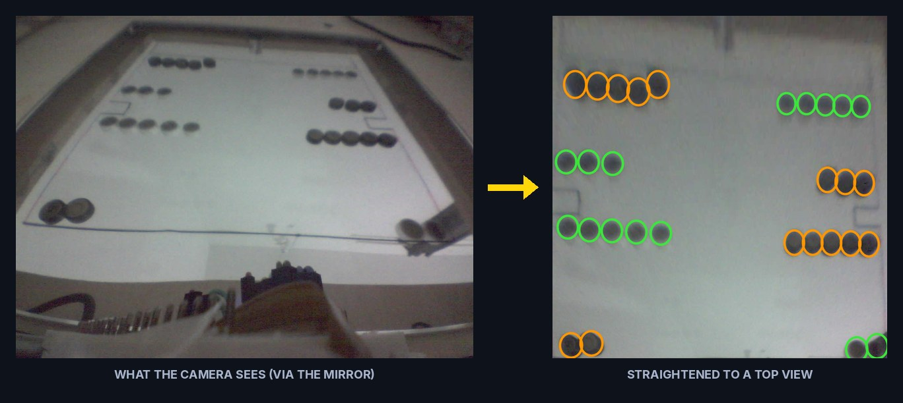

## It sets itself up

From two rows of checkers in the trays, the robot lays out the opening position on its own (sped up).

  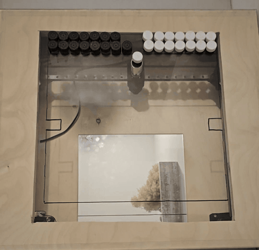

## The electronics

  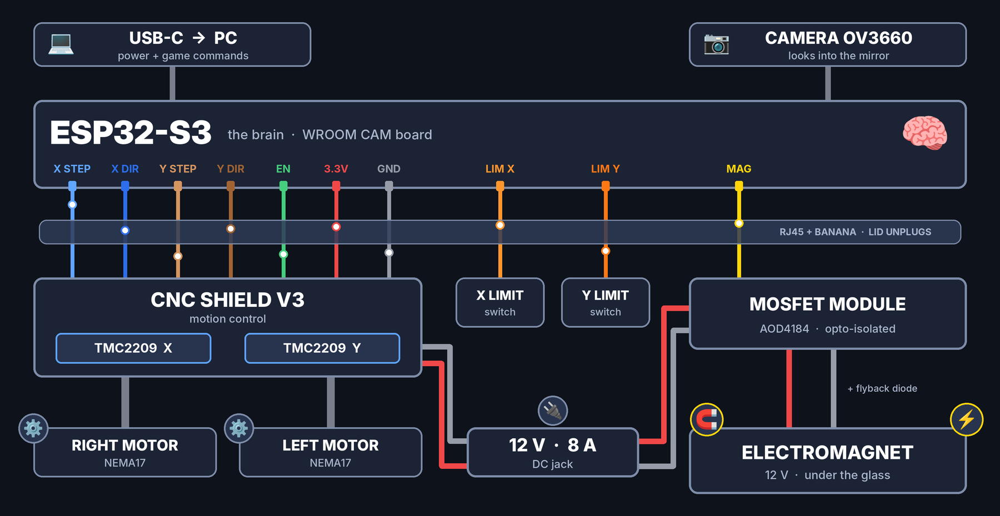

An ESP32-S3 drives two TMC2209 stepper drivers on a CNC Shield and switches the magnet through an opto-isolated MOSFET module. The PC talks to it over USB serial. The lid, with the controller and camera, unplugs from the box through an RJ45 and a banana connector. Every pin and wire is in the [detailed wiring diagram](electronics/wiring_diagram.png) and [wiring notes](electronics/wiring.md).

## Designed in Fusion 360

<table>
  <tr>
    <td width="45%" align="center">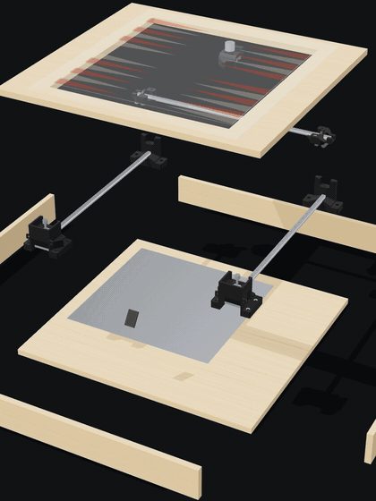</td>
    <td>
      Every part was modelled before it was built: the box, the CoreXY frame, the cart, the mirror and the camera mount.
        
      <a href="https://a360.co/4yloJTi"><b>Open the 3D model in your browser</b></a>
    </td>
  </tr>
</table>

## Ways to play

* **Against the computer.** GNU Backgammon picks the robot's moves, and the robot plays them on the board.
* **From far away.** A second player gets a private link and plays from a phone; the robot moves their checkers at home.
* **Two people at the board,** with the robot keeping track.
* **Robot against robot,** as a demo.

You play your own checkers by hand. The game runs in the browser on the PC (`pc/game.py`), with digital dice, an undo button and an advantage bar, and it also runs as a simulator with no hardware attached.

## Under the hood

| Part | What it is |
|---|---|
| Mechanics | CoreXY, MGN12 linear rails, GT2 belts, 2 × NEMA 17, wooden box, 4 mm tempered glass |
| Actuator | P30/25 12 V electromagnet, AOD4184 MOSFET module, flyback diode, heat budget enforced by the firmware |
| Controller | Freenove ESP32-S3 WROOM CAM, CNC Shield V3, 2 × TMC2209, 12 V 8 A supply |
| Link | USB serial at 921600 baud; one command per line in millimetres, answered `DONE` or `ERR` |
| Vision | OV3660 wide-angle camera looking into a mirror; calibrated by the robot itself, which carries a checker over a grid and photographs it |
| Software | Python on the PC: game logic, browser UI, GNU Backgammon engine, A* drag paths that keep 30 mm from other checkers, remote play over a secure tunnel |

## Repository

| Folder | Contents |
|---|---|
| [`pc/`](pc) | Everything that runs on the PC: the game, calibration and setup tools ([details](pc/README.md)) |
| [`firmware/`](firmware) | ESP32-S3 firmware: motion, homing, magnet, camera ([details](firmware/README.md)) |
| [`electronics/`](electronics) | Wiring diagram, wiring notes and wiring table |

<b>The original build plan</b>

  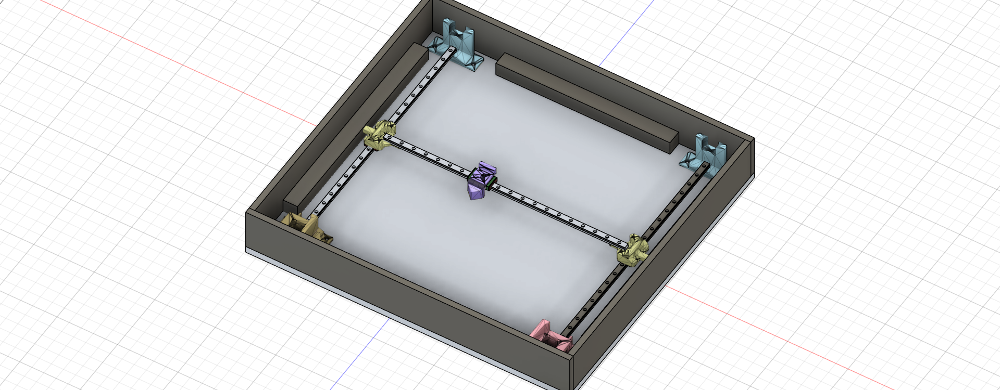
   <em>An early render: the CoreXY mechanism beneath the board</em>

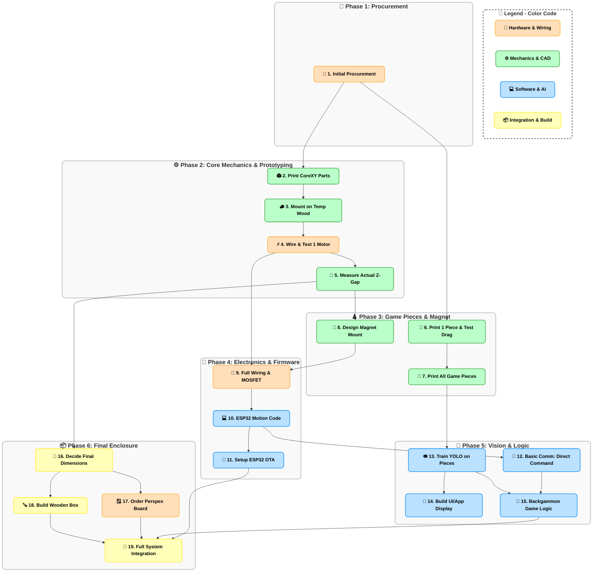

